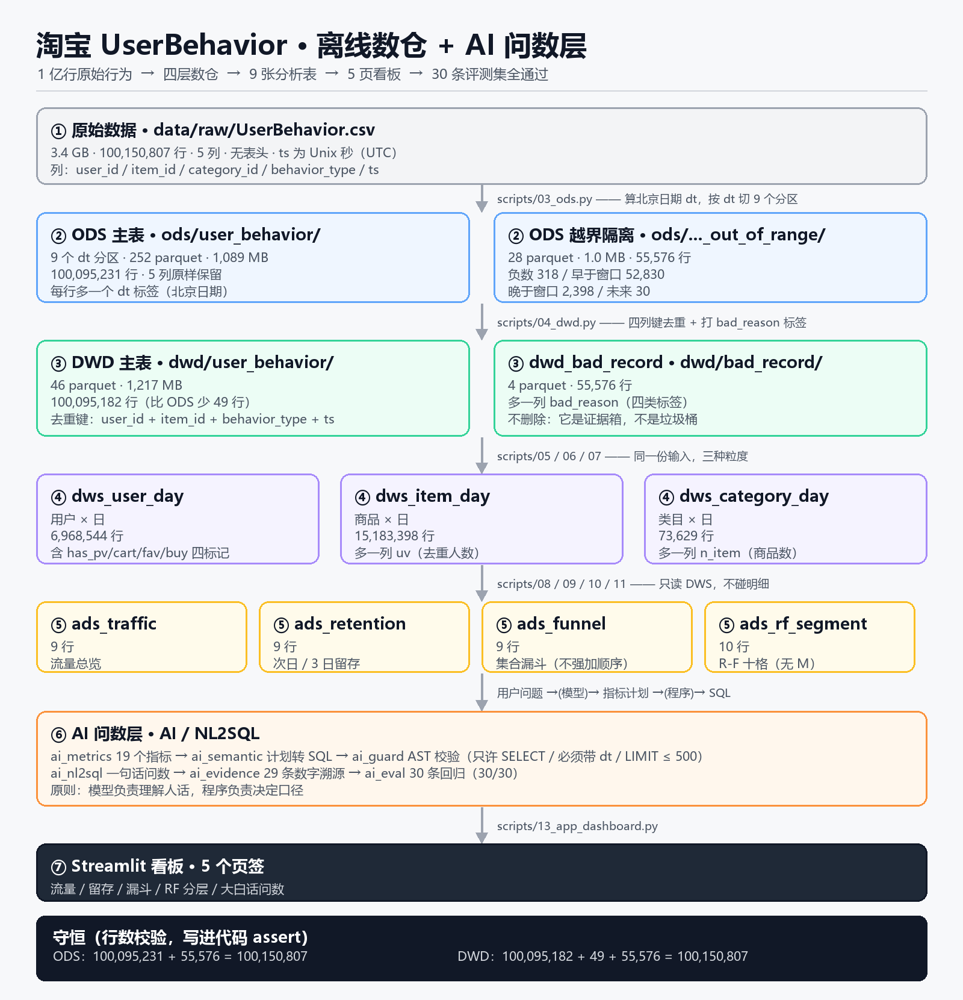

# 淘宝用户行为离线数仓 + AI 问数层

从 0 搭建四层离线数仓（ODS → DWD → DWS → ADS），并在 ADS 之上加一层
「用大白话问数」的 AI 分析层：模型只负责理解人话，指标口径由代码决定。

**核心数字**：1 亿行原始行为 → 分层清洗 → 9 张分析表 → 5 页看板 → 30 条评测集全通过。

---

## 1. 这个项目解决什么问题

淘宝用户行为数据是一个 **3.4 GB 的单个 CSV 文件**，1 亿行行为日志，无法直接查询：

- 查一天的 PV 要扫全文件
- 没有日期字段，日期要从 Unix 时间戳现算
- 55,576 行时间戳越界，混进来会把趋势图第一行打成 1902 年
- 业务方提问要写 SQL，不会 SQL 的人问不了数

**做两件事**：

1. **离线数仓**：把 1 亿行原始日志变成 9 张「一问就有答案」的表，每层都有行数守恒校验
2. **AI 问数层**：业务方用一句话提问，系统生成 SQL、执行、并用**可追溯的数字**回答

---

## 2. 数据

| 项 | 值 |
|---|---|
| 来源 | 阿里天池 UserBehavior（公开数据集） |
| 原始文件 | `data/raw/UserBehavior.csv`，3,672,347,465 字节（3.4 GB） |
| 行数 | **100,150,807** 行，无表头；MD5 已校验 |
| 列 | `user_id, item_id, category_id, behavior_type, ts` |
| 行为 | `pv`(浏览) / `cart`(加购) / `fav`(收藏) / `buy`(购买) |
| 时间 | `ts` 为 Unix 秒（UTC），北京时间 **2017-11-25 ~ 2017-12-03，共 9 天** |

### ⚠️ 数据边界（先说清，因为它决定了什么不能做）

- **无金额字段** → 不做 GMV、客单价、RFM 里的 M
- **无商品名、无类目名** → 类目只用 `category_id` 数字，不硬造名称
- **无用户属性**（注册时间、渠道、设备）→ 答不了“新客”“真实人数”
- **只有 9 天** → 只做次日 / 3 日留存，**绝不写月度留存**
- **是筛选过的样本**（购买率 19% vs 真实电商 1–5%）→ 比率只能横向比较，**不能当行业基准**

---

## 3. 架构



数据分四层，每层都有行数守恒校验。上图的数字都来自真实落盘结果：

- **ODS 收货区**（原样存）：按 `dt` 切 9 个分区 · **100,095,231 行** · 252 parquet · 1,089 MB
- **ODS 越界隔离**：**55,576 行**日期越界的记录单独存放，**不删除**
- **DWD 备菜台**（去重 + 打标）：四列键去重 · **100,095,182 行**（少 49 行）· 46 parquet · 1,217 MB
- **DWD 次品筐**：**55,576 行**，带 `bad_reason` 四类标签（负数 318 / 早于窗口 52,830 / 晚于窗口 2,398 / 未来 30）
- **DWS 配菜盘**（三种粒度）：
  - `dws_user_day` 用户 × 日 —— **6,968,544 行**
  - `dws_item_day` 商品 × 日 —— **15,183,398 行**
  - `dws_category_day` 类目 × 日 —— **73,629 行**
- **ADS 上桌**（只读 DWS，不碰明细）：流量 9 行 / 留存 9 行 / 漏斗 9 行 / RF 分层 10 行
- **AI 问数层**：19 个指标 → AST 守卫 → 问数 → 29 条数字溯源 → 30 条回归评测（30/30）
- **Streamlit 看板**：5 个页签（流量 / 留存 / 漏斗 / RF 分层 / 大白话问数）

---

## 4. 关键技术决策

> 这一节是项目的核心。每条都写「为什么」和「不这么做会怎样」。

| 决策 | 为什么 | 不这么做会怎样 |
|---|---|---|
| **显式指定 schema**，不用 `inferSchema` | 省一次全表扫描，类型不会被猜错 | 多扫 3.4 GB，且 `ts` 可能被猜成 string |
| **按北京时间分区**，不用 UTC | 业务按北京日期看数据 | 数据整体错 8 小时、12-02 被劈成两半，**且不报错** |
| **越界数据隔离**，不 `filter` 掉 | 那 4 万行是 11-24 的真实浏览，删了就永久丢失 | 无法追溯，也无法反查规则松紧 |
| **坏数据不删除**，进 `dwd_bad_record` | 它是证据箱不是垃圾桶，带 `bad_reason` 四类标签 | 数据异常时没有现场 |
| **去重键用四列**，不含 `category_id` | 类目是**时变属性**，进键会让“中途改类目”的重复漏过去 | 去重失效，且看不出来 |
| **按天拆分去重** | 键含 `ts`，`ts` 唯一决定属于哪天 → 跨天不可能重复 | 哈希表 4 GB，2G driver 直接 OOM |
| **DWS 建三个粒度** | 用户、商品、类目回答的问题不同，粒度错了指标就错 | 每问一次指标都重扫 1 亿行 |
| **漏斗用集合，不用时序** | 数据里真实存在“先买后浏览”（买完才看详情页） | 强行要求 `pv→cart→buy` 顺序，会把真实购买判成异常 |
| **RF 的 R/F 都用购买口径** | 用“最后一次行为”算 R，98% 的人 R=0，维度直接废掉 | 分层退化成“买过/没买过” |
| **模型只输出指标计划**，不写 SQL | 模型负责**理解人话**，程序负责**决定口径** | 口径会漂，同义词问法每次答案不一样 |
| **简报正文只允许出现 evidence 里的数** | 数字必须能追溯到一个指标 + 一条 SQL | 模型会编数（`0.1791` 和 `0.1790520` 差 4.8e-5 都算错） |

---

## 5. 数据质量与校验

**每一层都有「收银员」——行数守恒式写进代码，跑不通就红字报错。**

| 层 | 守恒式 | 实测 |
|---|---|---|
| ODS | 主表 + 越界 = 原始总量 | `100,095,231 + 55,576 = 100,150,807` ✅ |
| DWD | 主表 + 重复 + 次品筐 = 原始总量 | `100,095,182 + 49 + 55,576 = 100,150,807` ✅ |
| DWS | 三张表的 `n_action` 之和 = DWD 主表 | 三张都是 `100,095,182` ✅ |
| DWS（日粒度） | 各日行数之和 = 表总行数，且 `dt` 无 NULL | `Σ每日UV = 6,968,544 = 行数` ✅ |

**越界数据 55,576 行的四类分类（穷尽且相加等于总数）：**

| 类型 | 行数 | 占比 |
|---|---|---|
| 早于窗口（北京 11-24 的真实浏览） | 52,830 | 95.06% |
| 晚于窗口 | 2,398 | 4.32% |
| 负数时间戳 | 318 | 0.57% |
| 未来时间戳（≥ 2e9） | 30 | 0.05% |

**四层独立复算**：裸 Python 数行 → Spark 分层计数 → Parquet 读回 → DuckDB 读 Parquet，四条路径的同一个数必须一致。

---

## 6. AI 问数层（重点）

**架构**：不让模型写 SQL，而是「用户问题 →(模型)→ 指标计划 JSON →(程序)→ SQL →(守卫)→ 执行 →(溯源)→ 回答」。

| 组件 | 文件 | 作用 |
|---|---|---|
| 指标字典 | `ai_metrics.py` | 19 个指标 × 6 个维度，每个带中文名、口径公式、使用边界 |
| 语义层 | `ai_semantic.py` | 计划 → SQL，缺指标当场报错并给最近邻建议 |
| SQL 守卫 | `ai_guard.py` | sqlglot AST 校验：只许 SELECT、单语句、表白名单、**有 dt 必须过滤**、`LIMIT ≤ 500`、**禁止表函数** |
| 问数 | `ai_nl2sql.py` | 规则版（离线可用）+ LLM 版，认不出就拒答 |
| 数字溯源 | `ai_evidence.py` | 29 条 evidence，每条带指标 + SQL + 数值 |
| 指标简报 | `ai_report.py` | 7 段式简报，**正文零手打数字**，生成后自证 |
| 评测集 | `ai_eval.py` | 30 条：能答 12 / 该拒 12 / 数字正确 6 |

**三个证明「不编数字」的机制：**

1. **守卫自测 8/8** —— 非 SELECT、多语句、缺 dt、非白名单、表函数（`read_parquet('任意路径')`）、`LIMIT` 超限，全部拦住
2. **溯源校验** —— 把简报正文里所有数字抠出来，逐个比对 evidence；故意塞一个 `999,999` 能被抓出来
3. **30 条回归** —— 改完跑一遍，**准确率 30/30**；这是判断“改坏了没”的唯一依据

---

## 7. 我看到的 4 个结论

1. **12-02 大促：人来了，但没有多买** —— UV 从 74.0 万跳到 97.0 万（**+31.1%**），但人均浏览从 13.13 掉到 12.71（**−3.2%**），购买率 17.98% 是九天最低。**流量涨了不等于生意好了。**

2. **留存 78% 不能当行业指标** —— 九天去重用户只占全体 71.5%–74.9%，但 12-02 那天到齐了 **98.2%**；任何“留存到 12-02”的比例上限就是 98%，所以 12-01 之后跳到 98% 不是留存变好。

3. **超过一半的购买不走标准路径** —— 9 天口径下 53.69% 的买家“浏览过且购买过”，但**不走 `浏览→加购→购买` 标准路径的占 21.42%**；日口径下这个比例高达 56%–59%。**时序漏斗描述的只是少数人的走法。**

4. **高价值流失只能靠二维交叉才看得见** —— `R3_F3` 有 **25,144 人**：买过 4 次以上，但 5 天以上没再买。只看 R 会判成“流失”，只看 F 会判成“核心客户”，**只有交叉才看得见。**

---

## 8. 快速开始

**Windows 用户也可以直接双击根目录的 `start.cmd`**，它会自动切到项目目录、用 `.venv` 里的 Python 启动看板。

```powershell
# 1. 环境（Windows，Python 3.11，Java 17）
python -m venv .venv
.\.venv\Scripts\python.exe -m pip install -r requirements.txt
# 2. 数据（下载后放到 data/raw/UserBehavior.csv，3.4 GB）
#    天池 UserBehavior 数据集，MD5: 2c67e9b4e3908fd30a3f43ec95a7de8c

# 3. 逐层跑（顺序不能乱）
python scripts\00_count.py          # 数行数：100,150,807
python scripts\01_profile.py        # 八段体检
python scripts\02_check_item_cat.py # 商品↔类目唯一性
python scripts\03_ods.py            # ODS 落盘（252 parquet）
python scripts\04_dwd.py            # 去重 + 打标（49 重复 / 55,576 次品）
python scripts\05_dws.py            # 用户×日
python scripts\06_dws_item.py       # 商品×日
python scripts\07_dws_category.py   # 类目×日
python scripts\08_ads_traffic.py    # ADS 流量
python scripts\09_ads_retention.py  # ADS 留存
python scripts\10_ads_funnel.py     # ADS 漏斗
python scripts\11_ads_rf_segment.py # ADS RF 分层
python scripts\12_export_ads_csv.py # 导出 4 个 CSV
python scripts\ai_eval.py           # 30 条评测集回归：期望 30/30


# 4. 看板
streamlit run scripts\13_app_dashboard.py
```

**Windows 额外需要**：`winutils.exe` + `hadoop.dll`（Hadoop 3.3.x），并设置 `HADOOP_HOME` 和 `PATH`。
否则 Spark 写文件会报 `java.io.FileNotFoundException: HADOOP_HOME and hadoop.home.dir are unset.`

**AI 层需要 `.env`**（已在 `.gitignore` 里，不会提交）：

```text
OPENAI_API_KEY=sk-...
OPENAI_BASE_URL=https://api.deepseek.com/v1
OPENAI_MODEL=deepseek-chat
```

---

## 9. 目录结构

```text
data_warehouse/
├── README.md                       # 本文件
├── start.cmd                       # 一键启动看板（Windows 双击）
├── requirements.txt                # 依赖清单（钉死版本，别人能复现）
├── data/                           # 全部数据产物（不入库，几十 GB）
│   ├── raw/UserBehavior.csv        # 原始文件 3.4 GB
│   ├── ods/                        # 原样存，按 dt 分区
│   ├── dwd/                        # 去重后 + 次品筐
│   ├── dws/                        # 三个粒度
│   ├── ads/                        # 四张 ADS 表（parquet）
│   └── ads_csv/                    # 同款 CSV（给 BI / 复核用，入库）
├── docs/
│   ├── architecture.png            # 架构图（README 引用）
│   ├── data_profile.md             # 数据体检报告（规模 / 质量 / 边界）
│   └── 数据流向图.md                # 每层存哪、存了什么、谁写的、谁读的
└── scripts/                        # 26 个脚本，编号 = 执行顺序
    ├── 00_count.py ~ 12_export_ads_csv.py   # 数仓四层
    ├── 13_app_dashboard.py                  # Streamlit 看板
    ├── ai_bootstrap.py → ai_*.py            # AI 问数层
    └── check_dup.py / verify_dwd.py         # 一次性下钻与校验
```

---

## 10. 已知局限

- **只有 9 天** → 做不了季节性、月度留存、同环比
- **没有金额** → 无法回答任何和钱有关的问题（GMV、客单价、ARPU）
- **没有商品名 / 类目名** → 报告里只能出现 id 数字
- **样本是筛选过的** → 19% 的购买率不代表真实电商水平，比率只能横向比较
- **AI 层是单轮问答** → 不支持多轮追问（需要维护会话状态，且 9 天数据撑不起两轮以上的下钻）
- **252 个 parquet / 每文件约 4.3 MB** → 单机可接受，生产环境应合并成大文件
- **指标字典只有 19 条** → 覆盖不了开放域问题，答不了的会明确拒答

---

## 技术栈

Python 3.11 · PySpark 3.5 · Parquet · DuckDB 2.0 · sqlglot 30 · Streamlit · Git
